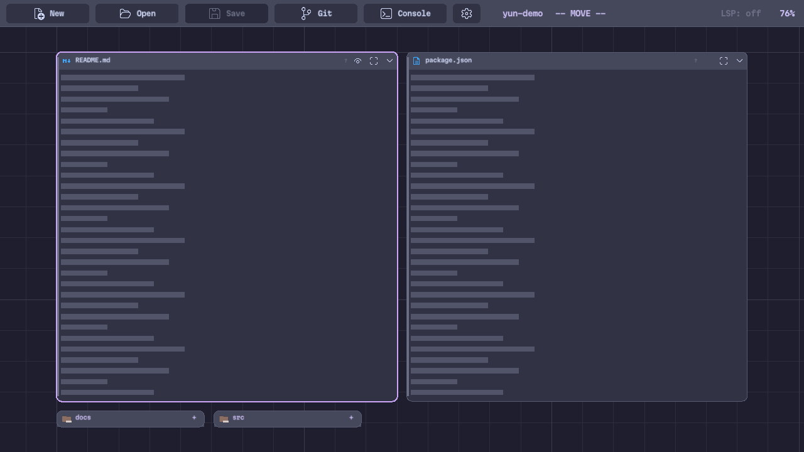

# Yun


Yun is a canvas-based code IDE written in [C3](https://c3-lang.org/) and rendered with **raylib 6**. Instead of tabs, files are movable cards laid out on an infinite pan/zoom canvas, with an embedded editor per card and folder clusters that mirror the project on disk.

The project is early and evolving quickly. The roadmap is the flat GitHub issue backlog: <https://github.com/MiguelCock/yun/issues>.

## Screenshots



## Features

- **Canvas** — infinite adaptive grid, drag-to-pan, cursor-anchored zoom, inertial pan, and a minimap overview.
- **Project** — open a folder from the CLI (`c3c run -- <dir>`) or the in-app browser; folder clusters mirror disk folders.
- **Files** — drop files onto the canvas, create new file cards and folders, resize cards, and use right-click context menus.
- **Editor** — a piece-table text buffer with undo/redo, line numbers and gutter, caret navigation and scrolling, UTF-8 input, in-file find (and replace), adjustable font size, and external-edit reload.
- **Syntax highlighting** — tree-sitter grammars for C3, C, C++, Java, Kotlin, Scala, C#, Go, Rust, Zig, Odin, V, Nim, Python, JavaScript, TypeScript, CSS, HTML, Lua, PHP, Ruby, R, Julia, Haskell, Gleam, SOL, Erlang, Elixir, Dart, and Markdown, loaded lazily from shared libraries, with embedded-language injections (PHP/HTML, HTML script/style, C++ raw strings, JS tagged templates, Haskell quasiquotes, Elixir sigils).
- **Search** — in-file find/replace, project-wide search, and a fuzzy symbol palette.
- **Dependencies** — import arrows between cards (configurable solid/dashed/dotted/long-dash/dash-dot line styles, independently for internal and external), with animated, line-highlighted jumps to results, definitions, and symbols. Card, selected, and cluster outlines stay a constant on-screen thickness when zoomed out. `Ctrl+Shift+I` opens a right-side **connections panel** with outgoing and incoming imports for the focused card or the hovered arrow; click a row to jump to the import.
- **LSP** — hover, go-to-definition, completion, and a problems panel, driven by per-language servers configured in the config.
- **Markdown preview** — toggle a rendered view of a Markdown card (headings, lists, tables, fenced code, blockquotes, links, inline emphasis) with `Ctrl+Shift+V`, the command palette, or the card-title preview icon; click the preview to jump back to the source. Card titles have maximize (focus mode) and minimize (collapse) controls; close cards from the context menu, `C`, or the command palette.
- **Themes** — nine built-in palettes with a picker.
- **App** — a top bar that can dock to any screen edge (`app.topbar_position`), consistent interaction states, delayed tooltips with shortcut hints, shared scrollbars, empty/loading states, reduced-motion panel transitions, top bar actions, Vim-like keyboard modes (see [Keyboard and modes](#keyboard-and-modes)), command palette, customizable keybindings, notifications, layered config (global + project), and `.yun/workspace.json` persistence. A freshly opened project starts with every folder collapsed: each level packs its files and folder chips tightly (wrapping at `sqrt` of their area into a roughly square footprint). Opening a folder reveals its contents overlapping its siblings on that level instead of pushing them aside, so arranging the canvas is left to you. The camera fits the visible content, never zooming past 100% (`canvas.fit_on_open` / `canvas.fit_min_zoom`); sub-3px cards are culled at low zoom and import arrows drop dashes/labels as they shrink. Folder positions and the camera are restored unchanged on reopen.

## Not yet

Lua mods (#33–#36), large-file support (#14), very-large-project perf (#45), crash recovery (#47), and release packaging (#48–#49).

## Keyboard and modes

Yun is keyboard-first and Vim-inspired. There are three modes, shown in the top bar (`-- MOVE --`, `-- EDIT --`, `-- TOP BAR --`), plus a `-- GRAB --` sub-state in MOVE. The status area also shows the current folder as a breadcrumb and elides it when space is tight. The top bar exposes New, Open, Save, Git, and Console, followed by a compact settings icon. The FPS counter is hidden by default; hold `F3` to show it with the performance overlay. Overlays (command palette, search, symbol palette, problems panel, find bar, menus, prompts) are modal and handle their own keys.

### MOVE (default)

The cursor is a card or folder on the canvas at the folder level you're in; no text is being edited. Arrows move between the current folder's direct children, so navigation follows the folder depth rather than every open card. Holding a movement key repeats the move after a short delay.

| Key | Action |
| --- | --- |
| `h` `j` `k` `l` / arrow keys | Move to the nearest card/folder left / down / up / right (current folder only) |
| `[` / `]` | Previous / next item in the current folder (wraps) |
| `Shift` + `h` `j` `k` `l` | Pan the canvas |
| `Enter` or `i` | Edit the selected card, or open and enter the selected folder |
| `Backspace` / `Esc` | Leave the current folder (up one level); `Esc` at the root clears the selection |
| `Tab` | Cycle focus: grab the selected card/folder, then focus the top bar, then back to MOVE |
| `z` | Resize the selected card to its minimum width and height |
| `=` / `+` / keypad `+` | Zoom in |
| `-` / keypad `-` | Zoom out |

When grabbed, hold `h` `j` `k` `l` (or the arrow keys) to glide the item smoothly at a constant on-screen speed — `Shift` slows it for fine placement — and press `Esc` or `Enter` to drop it.

Mouse panning, zooming, clicking and dragging still work as before.

### EDIT

Typing edits the focused card; arrow keys move the caret, `Shift+Up/Down` extends selection vertically, `Shift+Home/End` extends to line boundaries, `Ctrl+Left/Right` move by word, `Ctrl+Shift+Left/Right` select by word, `Ctrl+Backspace` / `Ctrl+Delete` delete words, `Tab` indents, and the usual editing shortcuts apply. `Esc` returns to MOVE and keeps the card selected, so you can keep browsing with `[` / `]`.

### TOP BAR

`Left` / `Right` move between buttons in the horizontal layouts and `Up` / `Down` in the vertical layouts (disabled ones are skipped). `Enter` / `Space` activate the selected one, and `Tab` or `Esc` return to MOVE. The focused button is outlined.

### Global shortcuts

These work from any mode:

| Key | Action |
| --- | --- |
| `Ctrl+Shift+P` | Command palette |
| `Ctrl+F` / `Ctrl+H` | Find / replace in the focused file |
| `Ctrl+Shift+F` | Search in project |
| `Ctrl+Shift+O` | Go to symbol |
| `F12` | Go to definition |
| `Ctrl+Shift+M` | Problems panel |
| `Ctrl+Shift+I` | Connections panel |
| `Ctrl+J` | Toggle the console panel |
| `Ctrl+Shift+G` | Toggle the Source Control panel |
| `Ctrl+Shift+T` | Theme picker |
| `Ctrl+N` / `Ctrl+O` / `Ctrl+S` | New / open / save |
| `Ctrl+Z` / `Ctrl+Y` | Undo / redo |
| `Ctrl+C` / `Ctrl+X` / `Ctrl+V` / `Ctrl+A` | Copy / cut / paste / select all |
| `Ctrl+Space` | Trigger completion |
| `Ctrl+Shift+Enter` | Toggle focus mode: the focused file fills the screen (top bar kept, file minimap bottom-right) |
| `Ctrl` + scroll | Editor font size |
| `F3` (hold) | Show the awake/asleep editor counter and frame/update/draw/scan timings |

Bindings are customizable via the `keymap` object in the config — global `~/.config/yun/config.json` or project `<root>/.yun/config.json` — e.g. `{ "keymap": { "save": "Ctrl+K" } }`.

The console runs shell commands from the project root. `Ctrl+J` opens and focuses it; `Enter` runs the command, `Up`/`Down` walk history, `Ctrl+L` clears output, `Ctrl+C` kills a running command, `Ctrl+Left/Right` move by word, `Ctrl+Backspace/Delete` delete words, `Ctrl+Shift+C` copies the selection (or all output), `Ctrl+F` searches output, and `Esc` returns focus while leaving the panel open. The top edge can be dragged to resize it. Console actions are registered commands, so they can be rebound on the Keys page. The Console settings page controls limits, ANSI colors, headers, wheel speed, clear-on-run, kill-on-close, notifications, and history/session persistence. `F5` runs the current project profile (or opens a picker when several exist). `Ctrl+T` starts a new session, `Ctrl+W` closes the active one, and `Ctrl+Tab` / `Ctrl+Shift+Tab` switch sessions; the session tabs appear in the console header. Panel visibility/height, active session, and command history are restored per project from `.yun/workspace.json`. Typing a prefix of a previous command shows the rest as ghost text; `Right`, `End`, or `Tab` accepts it, and `Esc` dismisses it (toggle under Settings → Console). ANSI colors from build tools and test runners are rendered.

The Source Control panel (`Ctrl+Shift+G`) shows the current branch, upstream, ahead/behind counts, merge conflicts, staged changes, working-tree changes, and untracked files. Click the branch row or press `B` to switch branches or create one from the current HEAD. The Fetch/Pull/Push/Sync buttons use the configured upstream and default remote; Push becomes Publish when the branch has no upstream. Pull is always `--ff-only`, and Yun never force-pushes. Click a file or focus the panel and press `Enter` to open it, `D` to view its diff, `C` to resolve a conflicted file, `H` to open history, `Space` to stage or unstage, and `Delete` to discard a working-tree change after confirmation. History shows recent commits; `Tab` switches to changed files and `Enter` opens a commit diff. The commit box supports multiline messages (`Ctrl+Enter` commits), and the panel has Stage All, Unstage All, Commit, Amend, and Refresh actions. Card and browser decorations use the same status. Diffs open in an overlay with inline and side-by-side modes (`Tab`); `[`/`]` select a hunk and `S`/`U` stage or unstage it. `Esc` returns to the panel. Git runs through argv arrays without a shell, reads status asynchronously, and never stores credentials. See [`docs/git.md`](docs/git.md) for the backend, security model, and limits.

## Getting started

Requires the external `c3c` compiler (built/tested with 0.8.4). On Linux, install the native dependencies listed in [`.github/workflows/ci.yml`](.github/workflows/ci.yml): `libx11-dev libxrandr-dev libxinerama-dev libxi-dev libxcursor-dev libgl1-mesa-dev`.

```sh
git clone --recurse-submodules https://github.com/MiguelCock/yun.git
cd yun

c3c build                 # build the `yun` executable
c3c run                   # run
c3c run -- <directory>    # run and open a project folder
c3c run -- --selftest     # boot, render a few frames, exit (headless smoke test)
c3c run -- --benchmark=200 --benchmark-frames=240   # synth N cards, scripted pan/zoom, print frame times
c3c run -- <directory> --benchmark --benchmark-frames=240   # benchmark a real project (card/folder count + frame times)
c3c benchmark             # micro benchmarks (hit-test, bounds cache, highlight runs)
c3c test                  # run the test suite
c3fmt --check $(git ls-files '*.c3')   # formatting check
```

Already cloned without submodules? Run `git submodule update --init --recursive`.

## Dependencies

- **raylib 6** — `lib/raylib6.c3l` is a packed library; it ships prebuilt static libs for `linux-x64`, `macos-aarch64`, `windows-x64`, `windows-aarch64`, `emscripten`, and `wasm-32`.
- **tree-sitter** — `lib/tree_sitter.c3l` (runtime, linked in) plus a `lib/tree_sitter_<lang>.c3l` grammar per supported language. Grammar shared libraries are built (not committed) with `scripts/build-tree-sitter.sh [--static] [target] [grammar...]` and loaded lazily at runtime. See [`docs/tree-sitter.md`](docs/tree-sitter.md).
- **Lua 5.4** — `lib/lua54.c3l` is a submodule vendored ahead of the mods work (#33–#36); it is not wired into the build yet.

## Layout

```
src/**      executable target `yun`
test/**     `@test` suite
lib/*.c3l   vendored libraries
assets/     bundled fonts (JetBrains Mono, SIL OFL 1.1)
```

See [`CONTRIBUTING.md`](CONTRIBUTING.md) for the branch/PR workflow, [`AGENTS.md`](AGENTS.md) for the build/architecture cheat sheet, and [`.opencode/skills/yun-development/SKILL.md`](.opencode/skills/yun-development/SKILL.md) for C3 conventions.

## Configuration

Settings are JSON, layered as `defaults < global < project`, so a project can override your global preferences:

- Global: `<OS config dir>/yun/config.json` (e.g. `~/.config/yun/config.json` on Linux).
- Project: `.yun/config.json` at the project root (wins over global).

Values are grouped into sections, for example:

```json
{
  "app": { "theme": "dark" },
  "editor": { "font_size": 16 },
  "keymap": { "save": "Ctrl+S" },
  "lsp": { "c3": "c3lsp" }
}
```

Unknown top-level keys or section keys warn and are ignored, and a missing config is valid (built-in defaults apply).

The `editor` section covers font size and family (monospace fonts found on the system), line height, padding, indentation (tabs or spaces + width), auto-indent, caret blink, scroll margin, wheel-scroll lines and the line-number gutter. The `app` section also sets the top bar edge (`topbar_position`: top, bottom, left, or right), short panel transitions (`animations`), the interface font (`ui_font_family`) and text size (`ui_font_size`), a global `ui_scale` factor that scales the whole interface (geometry and text), a `corner_radius` for cards/panels/controls (0 keeps sharp corners), the UI/file icon themes (`ui_icon_theme`, `file_icon_theme`), and `skip_submodules` (default on) which keeps nested git repositories (submodules, vendored deps) out of the project scan. File/language icon overrides can be placed in `~/.config/yun/icons/<theme>/<name>.png` (platform config directory); see [`assets/icons/README.md`](assets/icons/README.md). Text and layout scale automatically with the display's DPI. The `canvas` section tunes navigation (zoom limits and step, keyboard pan distance, pan/zoom smoothing and toggle, inertia friction and stop speed, drag threshold, max pan delta, grid toggle and cell size, grid snapping (on by default; hold Alt to bypass) and snap step, jump-zoom), and `minimap` controls the minimap (enabled, size and zoom threshold). The `arrows` section controls import connections (enabled, internal/external arrows and labels, line and hover thickness, arrowhead size, hover tolerance, rescan debounce and scan worker count). The `console` section controls retained output lines and size, history size and persistence, panel height, auto-scroll, wheel speed, ANSI colors, command headers, clear-on-run, kill-on-close, finish notifications, session restoration, and inline history autocomplete. The `git` section sets the Git binary, automatic refresh and debounce, discard confirmation, and the default remote. Git settings appear under Settings → Integrations. The `run` section defines named command profiles, for example `{ "run": { "build": { "command": "c3c build", "cwd": "src", "env": { "MODE": "debug" } } } }`; run one with `F5` or the palette.

Language servers are configured under the `lsp` section: a map of language id to command, e.g. `"lsp": { "c3": "c3lsp", "python": "pylsp" }`. Yun detects the language id from the file extension and starts the server (rooted at the project); an override takes precedence over the built-in default. See [`docs/lsp.md`](docs/lsp.md) for the supported ids and defaults.

In the editor, open the **Settings** panel with `Ctrl+Shift+S`, the top bar's settings icon, or the command palette. Settings are grouped into General, Appearance, Editor, Canvas, Integrations, Keys, Console, and Advanced pages; the sidebar switches pages, `Ctrl+1`…`Ctrl+8` jump directly, and typing searches across all pages. Changes apply live; `Tab` switches between the global and project scopes and `Del` resets the selected value. The **Keys** page lists every command's shortcut: `Enter` captures a new chord, `Del` unbinds, `Backspace` resets it (when the search is empty), `Esc` cancels or clears the search, and a *Reset all* row clears the current scope.

Keybindings use chords like `Ctrl+Shift+P`. Modifiers are `Ctrl` (shown as `Cmd` on macOS), `Shift`, `Alt` and `Super`; keys can be letters/digits, punctuation (`, . / ; ' [ ] - = \ \``), named keys (`Enter`, `Esc`, `Tab`, `Space`, `Backspace`, `Delete`, `Insert`, `Home`, `End`, `PageUp`, `PageDown`, `CapsLock`, `PrintScreen`, `Pause`), function keys `F1`-`F12`, or keypad keys (`KP_0`-`KP_9`, `KP_Add`, `KP_Subtract`, `KP_Multiply`, `KP_Divide`, `KP_Enter`). Set a command's chord to `""` to unbind it. Editor and completion actions (undo/redo, indentation, cursor movement, completion next/prev/accept), canvas/mode/top-bar navigation (pan, zoom in/out/reset/fit, item select/cycle, enter/leave folder, cycle focus/grab, minimize, focus switching), overlay navigation (lists, accept/close, find next/replace, search toggles) and card actions (close/toggle/rename/duplicate/copy-path/delete, context menu, focus content) are registered commands too, so they can be rebound the same way.

Bundled assets (fonts, icons, highlighting queries) are resolved from the current directory first and then from the executable's directory, so a shortcut or terminal can launch Yun from any working directory. Set `YUN_DEBUG_UI=1` to print window/render/monitor sizes, DPI and UI scale factors, theme and icon themes, asset paths, and the working/executable directories to stderr at startup.

## Versioning and releases

Yun is **pre-1.0** and version numbers communicate the size of a release:

- `0.0.x` — small change releases (patch).
- `0.x.0` — a large, stable batch of changes (minor).
- `1.0.0` — the first stable release.

The version lives in [`project.json`](project.json) (and `yun::version.APP_VERSION`, kept in sync by a test).

Releases are built and published by [`.github/workflows/release.yml`](.github/workflows/release.yml). **Merging a PR never publishes anything** — the workflow only builds. To cut a release, set the version in `project.json` and `src/version.c3` and push a matching tag:

```sh
git tag v0.3.0
git push origin v0.3.0
```

Tagging builds `linux-x64`, `macos-aarch64`, and `windows-x64` and attaches the archives (with SHA-256 checksums) to the GitHub Release. The tag must equal `v<version from project.json>`, otherwise publishing is aborted.

## License

Yun is released under the [MIT License](LICENSE). In short: use it however you like, but any copy or fork must keep the copyright and license notice.

Vendored libraries and assets keep their own licenses — see the `LICENSE` files inside each `lib/*.c3l`, and `assets/fonts/OFL.txt` for JetBrains Mono.
