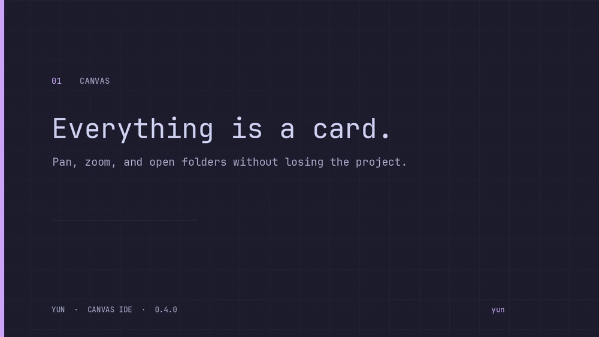
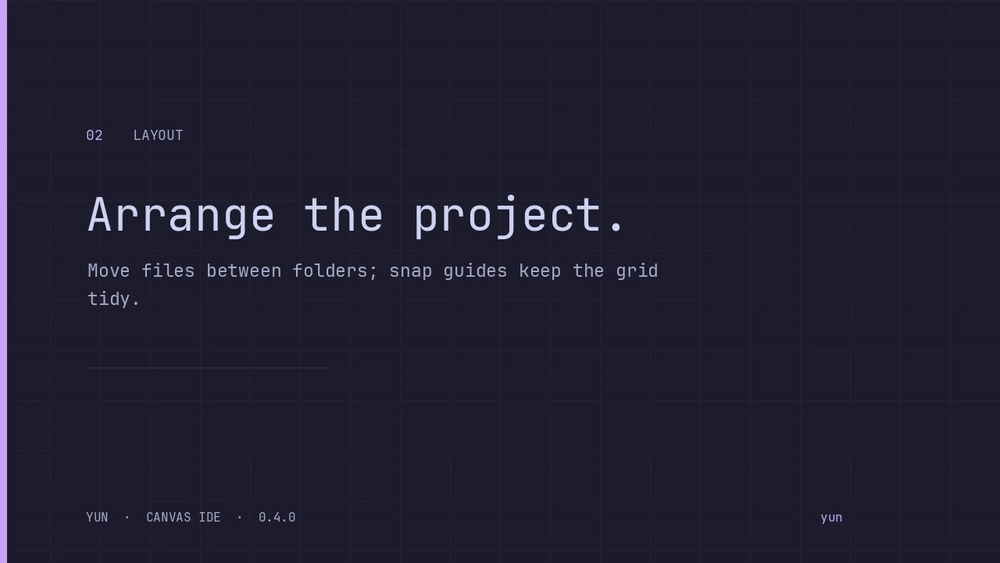
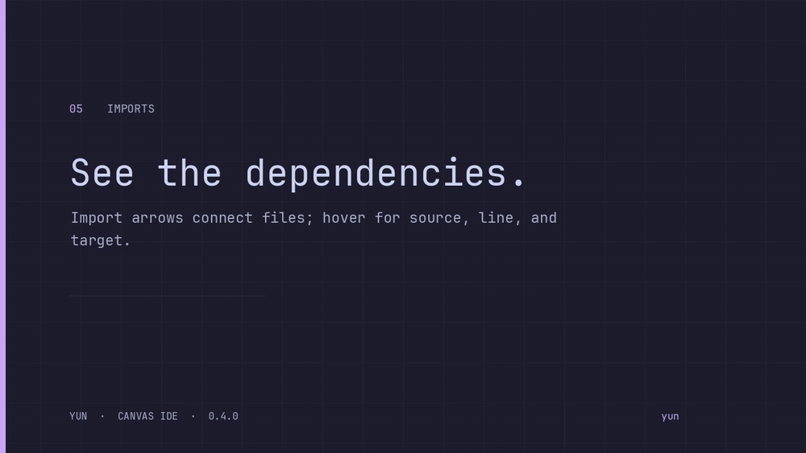
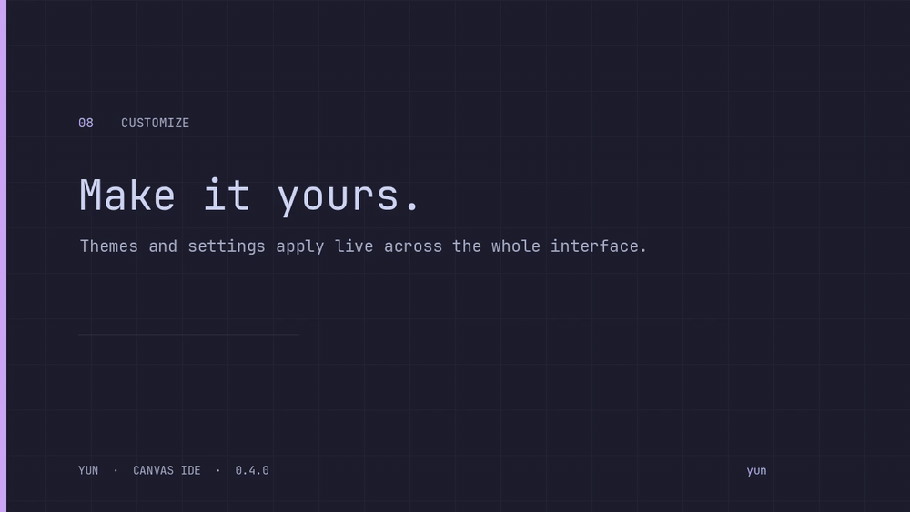
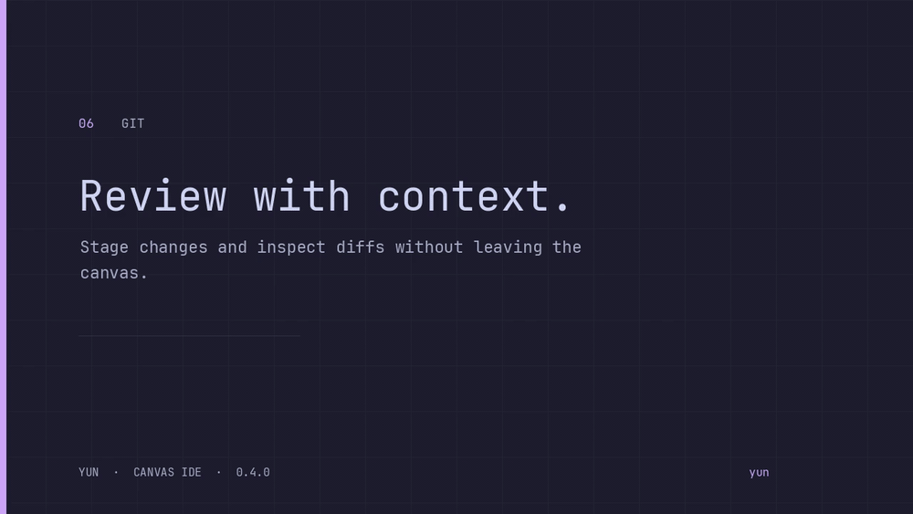

# Yun

[](https://github.com/MiguelCock/yun/actions/workflows/ci.yml)
[](https://github.com/MiguelCock/yun/releases/latest)
[](LICENSE)

**A canvas-first code IDE.** Yun turns a project into movable file cards and
folder clusters on an infinite pan/zoom canvas. Open, arrange, edit, search, and
review code without losing the shape of the project.

Built with [C3](https://c3-lang.org/) and raylib 6.



## Download

Prebuilt binaries are on the [latest release](https://github.com/MiguelCock/yun/releases/latest):

- **Linux x64** — `yun-*-linux-x64.tar.gz`
- **macOS arm64** — `yun-*-macos-aarch64.tar.gz`
- **Windows x64** — `yun-*-windows-x64.zip`

Extract the archive and run `yun` (`yun.exe` on Windows). There is currently no
Linux arm64 or macOS x64 build; use [Build from source](#build-from-source).

## Why a canvas?

- **The project stays visible.** Files are places, not disappearing tabs.
- **Arrange the code the way you think about it.** Drag cards, group folders,
  zoom out for the whole system, zoom in to edit.
- **Dependencies become spatial.** Import arrows connect files; Connections
  explains the external imports that have no project card.

## Demos

### Arrange the project



Move files between folders; snap guides keep the grid tidy while clusters resize
around them.

### See the dependencies



Select a file to draw its file-to-file import arrows. Hover an arrow for the
specifier, source line, and target card. External imports stay in Connections.

### Make it yours



Switch themes and change settings live. The top bar, icons, fonts, canvas, and
editor all restyle together. Skins can add an image or GIF to each surface
separately, from the app background to card, folder, panel, and top-bar chrome.

### Review with context



Stage changes, inspect inline or side-by-side diffs, and resolve Git work
without leaving the canvas.

More clips — editing, search, console, and top-bar chrome — are in the
[repo demo gallery](docs/guide/demos.md) and the
[GitHub wiki mirror](https://github.com/MiguelCock/yun/wiki).

## Features

- **Canvas** — infinite adaptive grid, pan/zoom, inertial navigation, minimap,
  fit-to-content, focus mode, low-zoom card LOD, and grid/deck/fan card layouts.
- **Project** — folder clusters mirror disk folders; drag cards between folders
  to move files; workspace layout and camera persist in `.yun/workspace.json`.
- **Editor** — piece-table buffers, undo/redo, line numbers, UTF-8 input,
  in-file find/replace, Markdown preview, Vim modal editing, external-edit reload,
  and a large-file highlighting limit.
- **Syntax highlighting** — lazy tree-sitter grammars for 50+ languages with
  embedded-language injections, including C3, C, C++, C#, Go, Rust, Zig, Odin,
  Python, JavaScript, TypeScript/TSX, JSON, YAML, TOML, SQL, Bash, HTML, Vue,
  HEEx, Lua, PHP, Ruby, R, Julia, Haskell, Gleam, SOL, Erlang, Elixir, Dart,
  LaTeX, and Markdown.
- **Search** — in-file find/replace, project-wide search/replace, fuzzy symbol
  palette, definitions, and the Connections panel.
- **Imports** — language-aware resolution, orthogonal file-to-file arrows,
  related-only display, minimum-zoom threshold, and external imports in
  Connections. See [docs/imports.md](docs/imports.md).
- **Git** — status, stage/unstage, commit/amend, inline and side-by-side diffs,
  hunk staging, branches, fetch/pull/push/sync, conflict resolution, and history.
- **Console** — command runner, ANSI output, history/completion, sessions,
  run profiles, and an optional persistent PTY terminal (ConPTY on Windows).
- **LSP** — hover, definition, completion, diagnostics, symbols, references,
  rename, code actions, signature help, semantic tokens, and inlay hints.
- **Mods** — sandboxed Lua 5.4 mods with lifecycle events, palette/context-menu
  commands, notifications, and optional render/input overlays.
- **App** — dockable top bar, command palette, customizable keybindings,
  notifications, themes/icons, DPI scaling, crash recovery, and layered config.
- **Skins** — per-surface PNG/GIF wallpapers, paper cards, ruled closed pages,
  explorer folders, language colours, and grid/deck/fan layouts. See
  [docs/skin.md](docs/skin.md).

## Install

### Prebuilt

Download the archive for your platform, extract it, and run the executable. Keep
`assets/` and `grammars/` beside it.

### Build from source

Requires the external `c3c` compiler (tested with **0.8.4**). On Linux install
`libx11-dev libxrandr-dev libxinerama-dev libxi-dev libxcursor-dev libgl1-mesa-dev`.

```sh
git clone --recurse-submodules https://github.com/MiguelCock/yun.git
cd yun

scripts/build-tree-sitter.sh linux-x64   # grammar libraries
c3c build                                # build/yun
c3c run                                  # run
c3c run -- /path/to/project              # open a project
c3c run -- --selftest                    # headless smoke test
c3c test                                 # test suite
```

Already cloned without submodules? Run `git submodule update --init --recursive`.

## Documentation

| Guide | What it covers |
| --- | --- |
| [Getting started](docs/guide/getting-started.md) | Download, build, first project |
| [Canvas and navigation](docs/guide/canvas.md) | Cards, folders, modes, pan/zoom, focus, grab |
| [Editing](docs/guide/editing.md) | Editor, highlighting, Markdown, Vim, files |
| [Search and connections](docs/guide/search.md) | Find/replace, symbols, Connections |
| [Import arrows](docs/guide/imports.md) | Arrow semantics, resolution, external imports |
| [Git](docs/guide/git.md) | Source Control, staging, diffs, branches |
| [Console](docs/guide/console.md) | Commands, PTY, sessions, run profiles |
| [LSP](docs/guide/lsp.md) | Server setup and features |
| [Mods](docs/guide/mods.md) | Lua mods and capabilities |
| [Settings and keybindings](docs/guide/settings.md) | Config, Keys page, themes, DPI |
| [Troubleshooting](docs/guide/troubleshooting.md) | Missing grammars, LSP, fonts, recovery |

The same guide is mirrored on the
[GitHub wiki](https://github.com/MiguelCock/yun/wiki). Technical references live
in [`docs/`](docs/): imports, Git, LSP, Markdown, mods, and tree-sitter.

## Quick keys

| Key | Action |
| --- | --- |
| `h` `j` `k` `l` / arrows | Select left/down/up/right |
| `Enter` / `i` | Open card or folder |
| `Esc` / `Backspace` | Leave editor or folder |
| `Tab` | Grab selected card/folder |
| `Shift` + movement | Pan canvas or move grabbed item finely |
| `=` / `-` / `0` / `f` | Zoom in / out / reset / fit |
| `Ctrl+F` / `Ctrl+H` | Find / replace in file |
| `Ctrl+Shift+F` / `Ctrl+Shift+H` | Search / replace in project |
| `Ctrl+Shift+P` | Command palette |
| `Ctrl+Shift+O` | Symbols |
| `Ctrl+Shift+I` | Connections |
| `Ctrl+Shift+G` | Source Control |
| `Ctrl+J` | Console |
| `Ctrl+Shift+T` | Theme picker |
| `Ctrl+Shift+Enter` | Focus mode |
| `F3` (hold) | Frame/update/draw/scan timings |

All bindings are rebindable from **Settings → Keys** or the `keymap` config
object.

## Configuration

Settings are layered:

```
built-in defaults < global config < project config
```

- Global: `<OS config dir>/yun/config.json` (Linux: `~/.config/yun/config.json`).
- Project: `.yun/config.json` at the project root.

Example:

```json
{
  "app": { "theme": "catppuccin_mocha" },
  "editor": { "font_size": 14, "vim_mode": false },
  "canvas": { "follow_selection": true },
  "arrows": { "related_only": true, "min_zoom": 0.05 },
  "keymap": { "save": "Ctrl+S" },
  "lsp": { "c3": "c3lsp" }
}
```

Unknown keys warn and are ignored. A missing config is valid. Project `.yun/`
also holds disposable import/symbol caches and the crash-recovery journal.

## Versioning and releases

Yun is pre-1.0:

- `0.0.x` — small patch releases.
- `0.x.0` — a large, stable batch of changes.
- `1.0.0` — first stable release.

The version lives in [`project.json`](project.json) and `yun::version.APP_VERSION`
(kept in sync by a test). Release builds are produced by
[`release.yml`](.github/workflows/release.yml) from a `v*` tag that must match
`project.json`.

```sh
git tag v0.4.0
git push origin v0.4.0
```

Tagging builds Linux x64, macOS arm64, and Windows x64 archives with SHA-256
checksums and publishes a GitHub Release. Merging a normal PR never publishes.

Release notes are kept in [`docs/releases/`](docs/releases/).

## Contributing

The branch model is `main` (release) ← `development` (integration) ←
`<issue>-<slug>` feature branches. Open PRs into `development`, keep CI green,
and reference the issue. See [CONTRIBUTING.md](CONTRIBUTING.md) and
[AGENTS.md](AGENTS.md).

## Known limitations

- Very large projects and full large-file indexing remain active work.
- LSP servers are user-supplied; Yun does not bundle them.
- Prebuilt targets are Linux x64, macOS arm64, and Windows x64.
- Windows runtime validation is still in progress.

## License

MIT. See [LICENSE](LICENSE). Vendored libraries and assets keep their own
licenses; see the `LICENSE`/`OFL.txt` files inside `lib/*.c3l` and
`assets/fonts/`.
