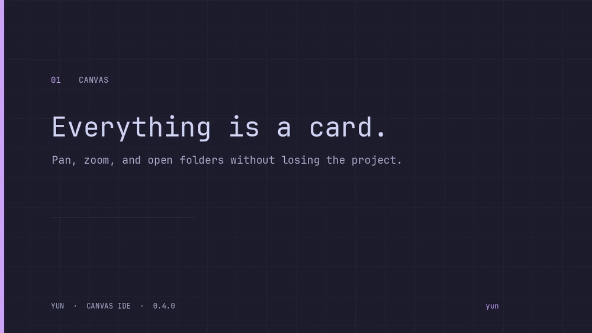

# Canvas and navigation

Yun's canvas is the project browser. Every file is a card, every folder is a
cluster, and arranging cards is part of arranging the project.

## Concepts

- **Card** — one file with an embedded editor and title controls.
- **Cluster** — a folder and its contents. Folders can collapse to a compact
  header and expand in place.
- **Workspace** — card positions, folder state, camera, and console sessions
  saved in `.yun/workspace.json`.

## Modes

The top bar shows the current mode:

- `MOVE` — select and organise cards/folders.
- `EDIT` — type in the focused file.
- `TOP BAR` — navigate the top bar with the keyboard.
- `GRAB` — move the selected card or cluster.

## Move around

| Action | Keys |
| --- | --- |
| Select left/down/up/right | `h` `j` `k` `l` or arrow keys |
| Previous/next item | `[` / `]` |
| Open card or folder | `Enter` or `i` |
| Leave folder | `Backspace` or `Esc` |
| Pan canvas | `Shift` + `h` `j` `k` `l` |
| Zoom | `=` / `-` or the top-bar controls |
| Fit all content | `f` |
| Reset zoom to 100% | `0` |
| Grab selected item | `Tab` |
| Move grabbed item | `h` `j` `k` `l`; hold `Shift` for fine movement |
| Drop grabbed item | `Enter` or `Esc` |

Mouse panning, wheel zoom, dragging, resizing, and title buttons work too. Grid
snapping applies after intentional movement; selecting or cancelling a grab
does not move the card.

## Folder clusters

A freshly opened project starts with every folder collapsed. Opening a folder
reveals its files and child folders in place. Expanding or collapsing changes
what is visible without throwing away the saved layout.

The camera fits visible content on first open, with a floor controlled by
`canvas.fit_min_zoom`.

## Focus mode

Press `Ctrl+Shift+Enter` to fill the screen with the selected card. The top bar
and a file minimap remain visible. The same shortcut leaves focus mode.

## Level of detail

At low zoom the canvas draws cards as simplified blocks with title-only detail,
then as plain cards, so a project with hundreds of open files stays responsive.
Zoom back in to restore full chrome and editor content.
