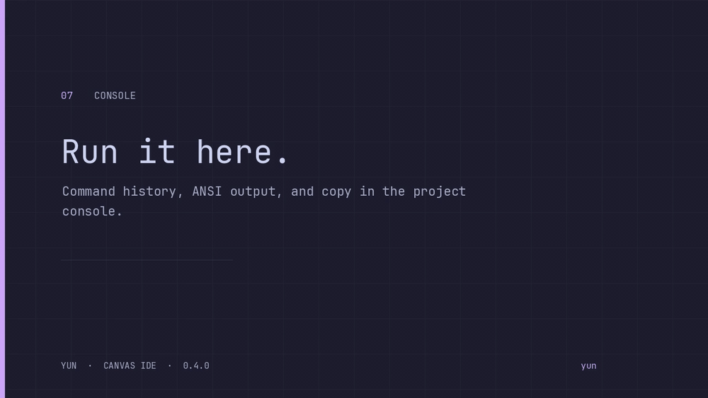

# Console



The bottom console runs commands from the project root and keeps output in
scrollable sessions.

## Command runner

Open with `Ctrl+J`, type a command, and press `Enter`. `Up`/`Down` walk history;
a typed prefix shows matching history as ghost text, and `Right`/`End`/`Tab`
accepts it.

- `Ctrl+L` clears output.
- `Ctrl+C` kills the running command tree.
- `Ctrl+F` searches output.
- `Ctrl+Shift+C` copies the selection or all output.
- `Ctrl+Left`/`Ctrl+Right` move by word; `Ctrl+Backspace`/`Ctrl+Delete` delete
  words.
- `Esc` leaves console focus without closing the panel.

ANSI colors from compilers and test runners are rendered. Output and history
limits, panel height, auto-scroll, headers, clear-on-run, kill-on-close,
notifications, and persistence are configurable under `console`.

## Interactive terminal

Enable **Settings → Console → Interactive terminal** (`console.pty`) to use a
persistent shell instead of one-shot commands. The panel becomes a terminal grid
with raw keyboard input.

- `Ctrl+C` interrupts the foreground process.
- `Ctrl+V` pastes.
- `Ctrl+Shift+C` copies the screen.
- `Ctrl+Esc` leaves console focus without sending Esc to the shell.

On POSIX the terminal uses `/bin/sh -i`; on Windows it uses ConPTY with
`cmd.exe`. If a PTY cannot be allocated, Yun reports the failure and falls back
to the command runner.

## Sessions and profiles

`Ctrl+T` starts a session, `Ctrl+W` closes it, and `Ctrl+Tab`/`Ctrl+Shift+Tab`
switch sessions. Visibility, height, active session, and history are restored
from `.yun/workspace.json`.

`F5` runs a project profile from the `run` config section, or opens a picker when
several profiles exist:

```json
{
  "run": {
    "build": { "command": "c3c build", "cwd": "src" },
    "test": { "command": "c3c test" }
  }
}
```

Commands run with your permissions. Yun does not sandbox the shell.
