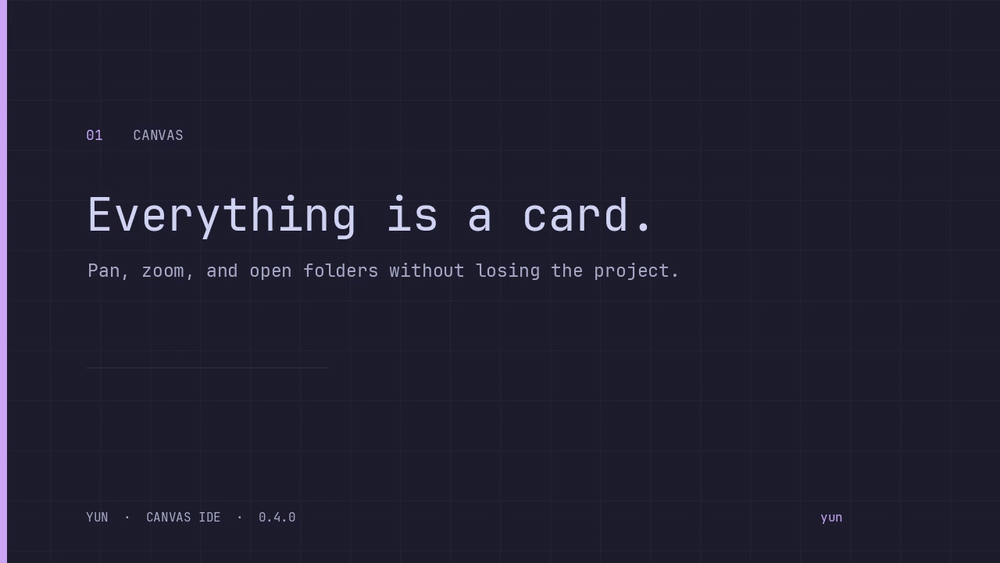
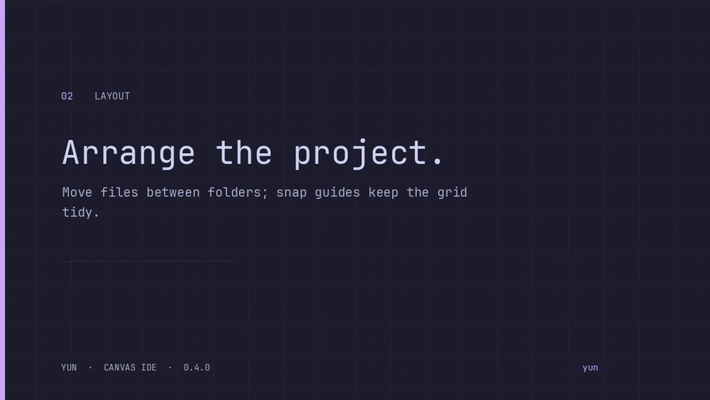
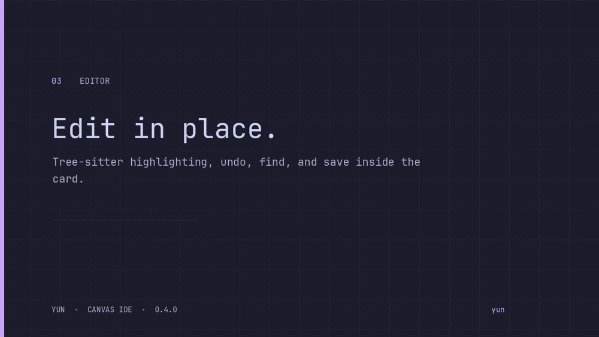
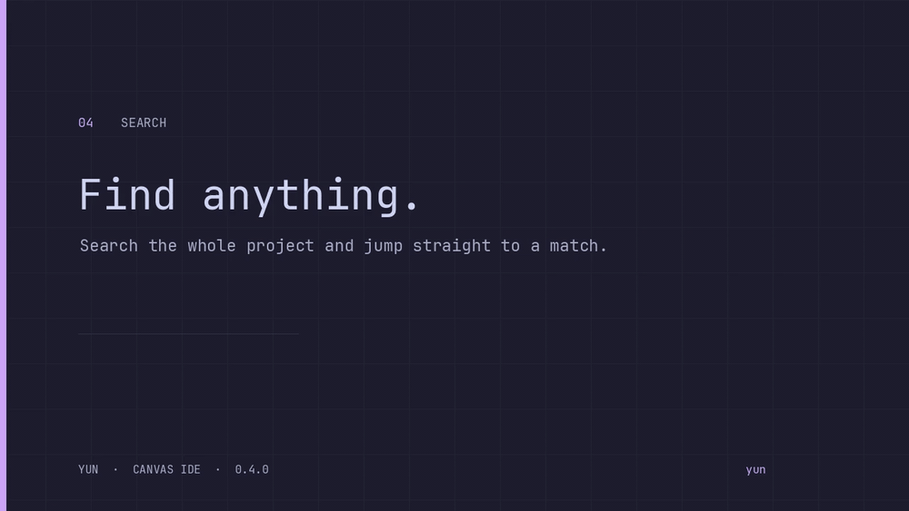
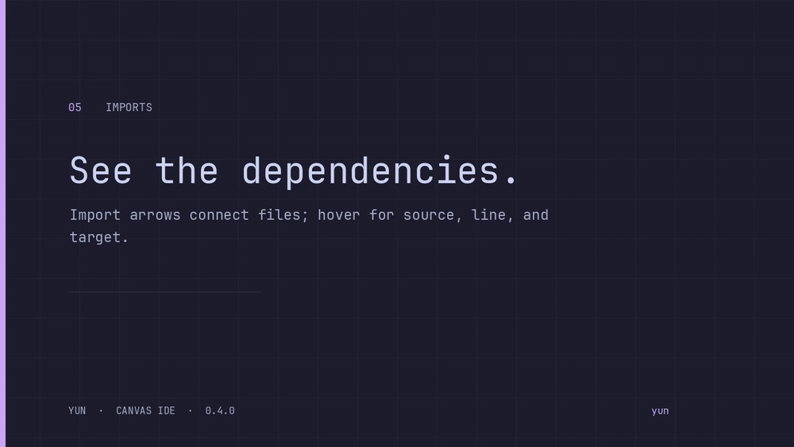
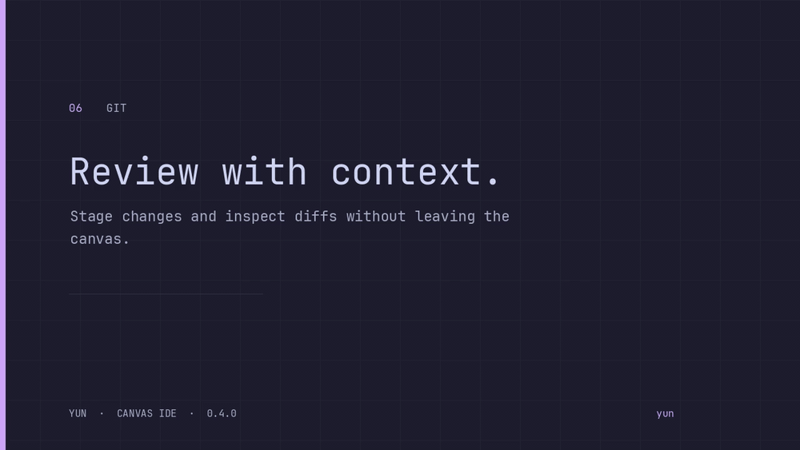
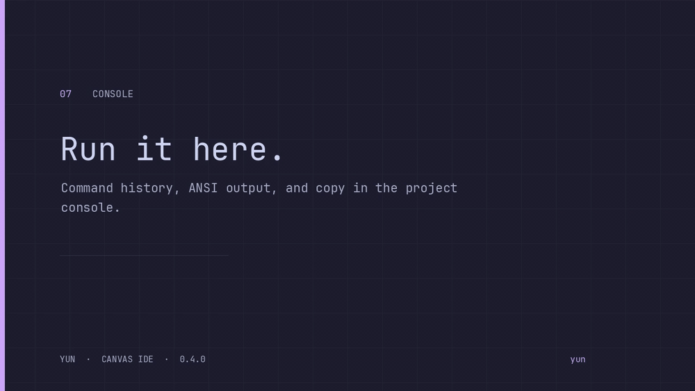
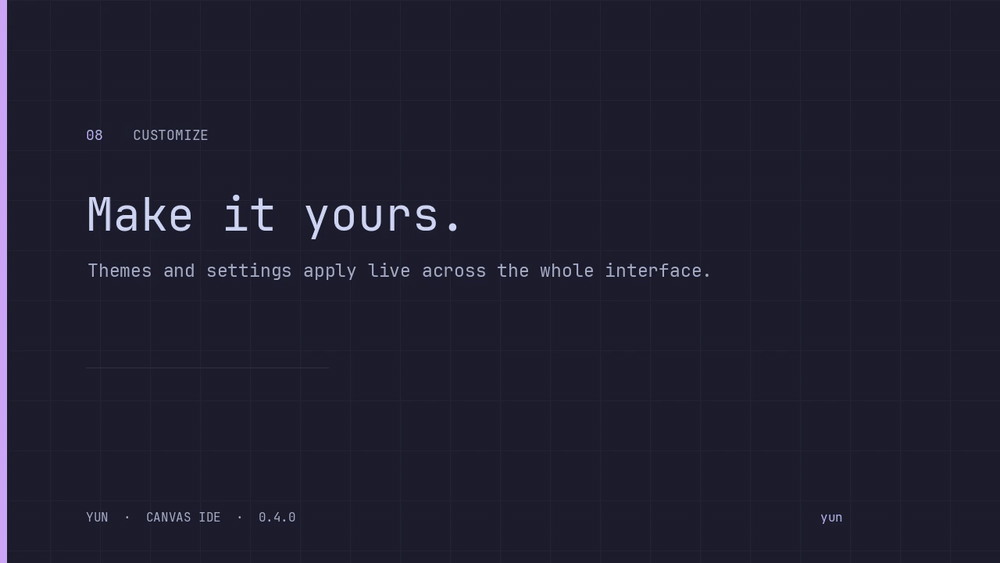
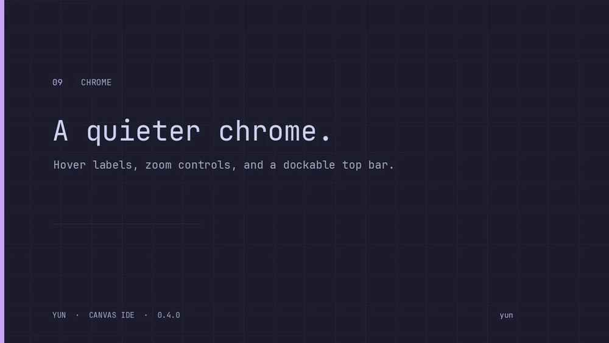

# Demo gallery

Short, silent clips of Yun in motion. Each starts with a title card and is best
viewed at full size.

## 01 · Canvas

Everything is a card. Pan, zoom, and open folders without losing the project.

## 02 · Layout

Move files between folders; snap guides keep the grid tidy.

## 03 · Editor

Tree-sitter highlighting, undo, find, and save inside the card.

## 04 · Search

Search the whole project and jump straight to a match.

## 05 · Imports

Import arrows connect files; hover for source, line, and target.

## 06 · Git

Stage changes and inspect diffs without leaving the canvas.

## 07 · Console

Command history, ANSI output, and copy in the project console.

## 08 · Customize

Themes and settings apply live across the whole interface.

## 09 · Chrome

Hover labels, zoom controls, and a dockable top bar.
