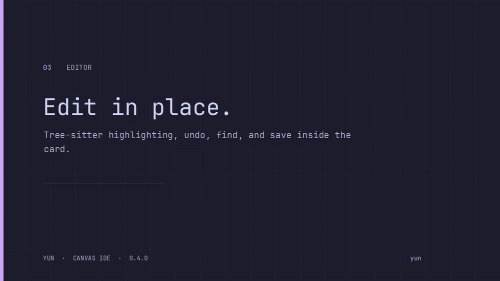

# Editing

Yun's editor is a piece-table text buffer with syntax highlighting from
tree-sitter. Each card keeps its own cursor, scroll position, undo history, and
highlighting state.

## Open and edit

Select a card and press `Enter` or `i`. The top bar changes to `EDIT` and the
caret appears in the card. Press `Esc` to return to `MOVE`; the card stays
selected.

The card title shows a dirty dot while the buffer has unsaved changes. Save with
`Ctrl+S` or the top-bar save action. When another program changes a file, Yun can
reload it or keep your buffer.

## Editing keys

- Caret: arrow keys, `Home`/`End`, `PageUp`/`PageDown`
- Word movement: `Ctrl+Left` / `Ctrl+Right`
- Selection: `Shift` + movement keys
- Word deletion: `Ctrl+Backspace` / `Ctrl+Delete`
- Indent/outdent: `Tab` / `Shift+Tab`
- Undo/redo: `Ctrl+Z` / `Ctrl+Y`
- Copy/cut/paste/select all: `Ctrl+C` / `Ctrl+X` / `Ctrl+V` / `Ctrl+A`
- Find/replace in file: `Ctrl+F` / `Ctrl+H`

## Syntax highlighting

Grammars are loaded lazily from the release's `grammars/` directory. Yun
supports C3, C, C++, C#, Go, Rust, Zig, Odin, V, Nim, Python, JavaScript,
TypeScript, TSX, JSON, YAML, TOML, SQL, Bash, XML, Diff, Dockerfile, INI, CSV,
HCL, Nix, GraphQL, CSS, SCSS, Sass, Less, HTML, Vue, HEEx, Lua, PHP, Ruby, R,
Julia, Haskell, Gleam, SOL, Erlang, Elixir, Dart, LaTeX, and Markdown, including
embedded-language injections.

Large files above `editor.highlight_max_mb` (4 MB by default) render as plain
text instead of being parsed.

## Markdown preview

Markdown cards can switch between source and a rendered preview with
`Ctrl+Shift+V`, the card title preview icon, or the command palette. The preview
supports headings, lists, tables, fenced code, blockquotes, links, and inline
emphasis.

## Vim mode

Enable `editor.vim_mode` in settings or config. Vim mode adds normal/visual
modes, operators, counts, registers for common operations, and a `:` command
line integrated with search and save. The command palette still works from any
mode.

## File handling

- New files and folders: top bar or context menu.
- Rename/duplicate/delete/copy path: context menu, card shortcuts, or command
  palette.
- Drag a card over a folder cluster to move the file on disk.
- Duplicate a card to create a copy beside it.

## Next

- [Search, symbols, and connections](search.md)
- [Settings and keybindings](settings.md)
