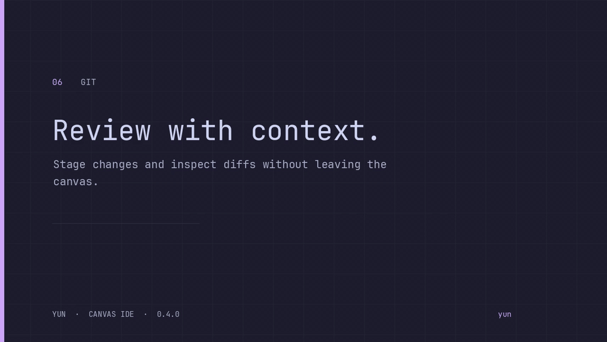

# Git

Yun runs the system Git executable directly. It never constructs a shell command
and never stores credentials.

Open the **Source Control** panel with `Ctrl+Shift+G` or the top-bar Git action.

## Status and staging

The panel shows the current branch, upstream, ahead/behind counts, merge
conflicts, staged changes, working-tree changes, and untracked files.

- `Space` stages or unstages the selected file.
- `Enter` opens the selected file.
- `D` opens its diff.
- `C` opens a conflicted file for resolution.
- `H` opens commit history.
- `Delete` discards a change after confirmation.
- Stage All, Unstage All, Commit, Amend, and Refresh are available at the bottom.

Card and browser decorations use the same status.

## Diffs

Diffs open in an overlay. `Tab` switches between inline and side-by-side views.
Use `[`/`]` to select a hunk, `S` to stage it, `U` to unstage it, and `Esc` to
return to the panel.

## Branches and remotes

Click the branch row or press `B` to list branches, switch, or create one from
the current HEAD. Fetch, Pull, Push, and Sync use the configured upstream and
default remote. Push becomes Publish when the branch has no upstream. Pull is
always `--ff-only`; Yun never force-pushes.

## History

History shows recent commits. `Tab` switches to the changed-file list; `Enter`
opens a commit diff. Commit messages can span multiple lines; `Ctrl+Enter`
commits.

See the [Git backend reference](../git.md) for command lines, timeouts, output
caps, and the security model.
