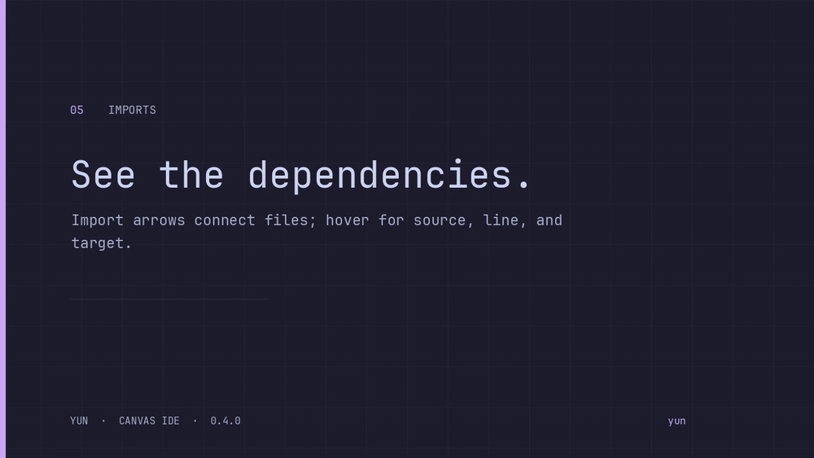

# Import arrows

Yun parses each file's imports with tree-sitter and connects the actual importing
and imported cards.

## What the arrows mean

- An arrow starts at the importing file and ends at the resolved project file.
- Arrow paths are orthogonal: horizontal and vertical segments with 90-degree
  turns.
- Hovering an arrow shows the import specifier, source file/line, and target.
- Clicking an arrow jumps to its source or target.
- Imports that resolve outside the project — standard library, third-party
  packages — are **not** arrows. They are listed in Connections.

## Related arrows

By default, only arrows touching the selected, focused, or hovered card are
shown. This keeps a large canvas readable. Disable `arrows.related_only` to draw
every visible file-to-file arrow.

## Zoom and density

`arrows.min_zoom` defaults to `0.05` (5% zoom), so arrows remain available at
far zoom. Labels appear at 50% zoom or closer. The arrow line style, thickness,
arrowhead size, hover tolerance, scan workers, and debounce are configurable in
the `arrows` settings section.

## Resolution

Resolution is language-aware and uses the nearest module root. For example:

- C3: module name or a path under `src/`.
- C/C++: relative include or search roots.
- TypeScript/JavaScript: relative paths, index files, `baseUrl`/`paths`.
- Go: module prefix from `go.mod`.
- Rust: `mod` files and crate paths.
- Python, Ruby, PHP, Java, Kotlin, Scala, C#, Lua, and others: conventional
  source roots and manifest mappings.

See the [technical import reference](../imports.md) for every language rule,
manifest reader, and extension point.

## Next

- [Search, symbols, and connections](search.md)
