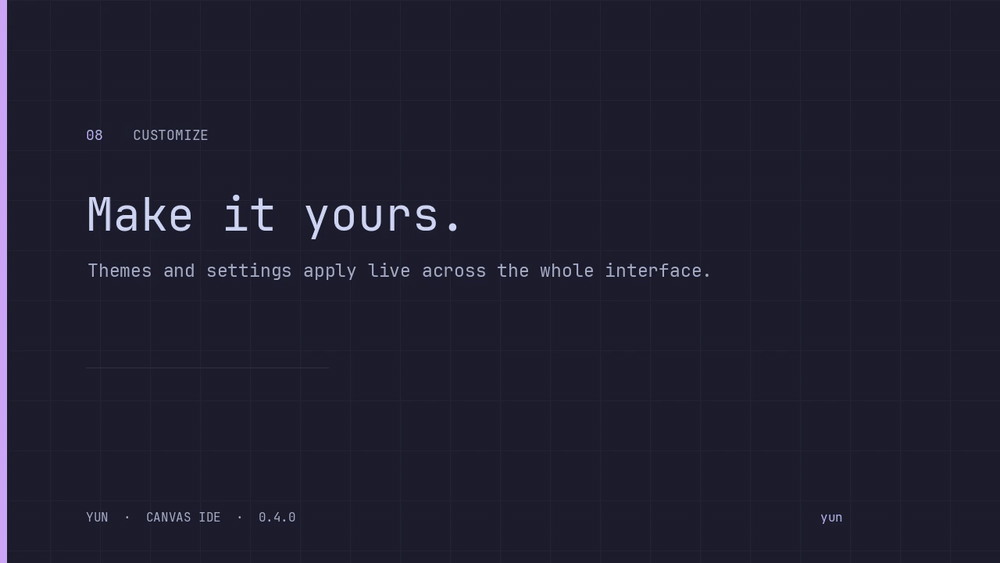

# Settings and keybindings



Open Settings with `Ctrl+Shift+S`, the top-bar settings icon, or the command
palette. Settings are grouped into General, Appearance, Editor, Canvas,
Integrations, Keys, Console, and Advanced.

## Config layers

Settings are JSON with three layers:

```
built-in defaults < global config < project config
```

- Global: `<OS config dir>/yun/config.json` (for example
  `~/.config/yun/config.json` on Linux).
- Project: `.yun/config.json` under the project root.

Unknown keys warn and are ignored. Changes in the Settings panel apply live.
`Tab` switches the global/project scope; `Del` resets the selected value.

## Common sections

- `app` — theme, UI font/scale, corner radius, icon themes, top-bar position,
  animations, external reload, sleep-editors, submodule scanning.
- `editor` — font size/family, line height, padding, indentation, caret blink,
  scroll margins, wheel lines, line numbers, Vim mode, autosave, undo budget,
  large-file highlighting limit.
- `canvas` — zoom limits/step, pan/zoom smoothing, inertia, drag threshold,
  grid, snapping, fit-on-open, follow-selection.
- `arrows` — enabled, related-only, minimum zoom, labels, line/hover thickness,
  arrowhead size, hover tolerance, rescan debounce, workers, line style.
- `search` — file-size/match/result limits, workers, debounce, preview length.
- `console` — output/history limits, panel height, auto-scroll, ANSI colors,
  headers, clear-on-run, kill-on-close, notifications, persistence, PTY.
- `git` — binary, auto-refresh and debounce, discard confirmation, remote.
- `lsp` — language-id to server command mapping.
- `mods` — enable mods and grant render/input capabilities.
- `run` — named command profiles for `F5`.

## Keybindings

The **Keys** page is a searchable card grid grouped by General, Canvas, Editor,
Console, Overlays, Settings, and Top bar. Each row shows the command, description,
current chord, source badge, and conflict marker.

- `Enter` or click a shortcut chip to capture a new chord.
- `Del` unbinds; `Backspace` resets the selected command.
- `Esc` cancels or clears search.
- Chords use `Ctrl`, `Shift`, `Alt`, `Super`, letters/digits, punctuation, named
  keys (`Enter`, `Esc`, `Tab`, `PageDown`, function keys, keypad keys), for
  example `Ctrl+Shift+P`.

Bindings can also be written directly under `keymap`:

```json
{
  "keymap": {
    "save": "Ctrl+S",
    "toggle_console": "Ctrl+J"
  }
}
```

## Appearance

Themes are built-in palettes; the theme picker (`Ctrl+Shift+T`) applies them
live. UI scale, UI font, corner radius, and icon themes are under Appearance.
File/language icon overrides can be placed in
`<config dir>/yun/icons/<theme>/<name>.png`.

## DPI

Text and layout scale with the display DPI. Set `YUN_DEBUG_UI=1` to print window,
render, monitor, DPI, theme, asset, and working-directory diagnostics to stderr.

## Top bar

`app.topbar_position` can be `top`, `bottom`, `left`, or `right`. The top bar is
icon-first: labels expand on hover or keyboard selection.
