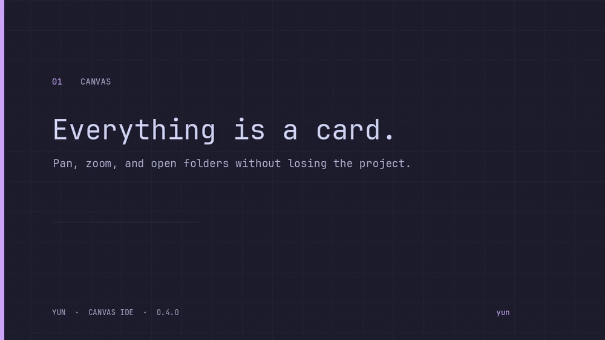

# Yun 0.4.0

Yun 0.4.0 is the largest post-0.3.0 batch: mods, an interactive terminal, Vim
editing, a much better import graph, and a substantial canvas performance pass.

## Highlights

- **Lua mods** — a sandboxed Lua 5.4 runtime, versioned API, lifecycle/input/draw
  events, palette and context-menu commands, notifications, and memory/instruction
  budgets (#33–#36, #182, #183).
- **Interactive terminal** — PTY sessions, terminal screen model, raw input,
  ANSI output, selection/copy, search, sessions, and Windows ConPTY (#312,
  #324, #325).
- **Vim modal editing** — normal/visual modes, operators, counts, and a `:`
  command line integrated with save/search (#254, #255, #259).
- **Connections and imports** — imported symbols, aliases, usage sites, outgoing
  and incoming importer lists, and external packages in one panel (#372).
- **Canvas and top-bar polish** — icon-first animated top-bar labels, centered
  camera follow, intentional-move snapping, straight import arrows, arrows-above
  toggle, project-wide replace, and zoom controls with anchor fixes
  (#405–#412).

## Import graph changes

Import arrows now connect **actual file cards only**, with no folder-level
aggregation. Routes are orthogonal with 90-degree turns and detour around
adjacent cards. Related-only display is the default, external imports stay in
Connections, and the minimum draw zoom is configurable (`arrows.min_zoom`,
default 5%). This also removes the confusing folder bounding-box arrows from
0.3.0.

## Editor and search

- Large-file highlighting limit and faster line indexing (#14).
- Reliable shift line selection and word-wise navigation/deletion (#336, #252).
- Project-wide search and replace with a top-bar entry (#411).
- Compact keybinding browser with descriptions, conflicts, and scope badges
  (#370).

## Console

- Bottom console with output, history, ANSI colors, find, copy, horizontal
  scroll, word navigation, and process-tree kill (#256–#307).
- Sessions, persistence, inline history autocomplete, and run profiles
  (#309, #322).
- Configurable console page and limits (#299, #343).
- PTY terminal and Windows ConPTY backend (#312, #324, #325).

## Performance and reliability

- Binary import/symbol index caches and lazy symbol scanning (#387).
- Crash-recovery journal for dirty buffers (#47).
- Low-zoom card LOD and cached import edges; removed a per-frame folder-bounds
  invalidation that cost a full core on large layouts.
- Focused 48% / 1920×1080 benchmark on a 654-card workspace dropped from roughly
  one full CPU core to about 12%.

## UI

- Consistent hover/pressed/focus/disabled states (#378).
- Tooltips with shortcut hints (#377).
- Shared styled scrollbars (#375).
- Empty/loading states and panel chrome (#376).
- Reduced-motion panel transitions (#374).
- Dockable top bar on any screen edge (#251).
- Delayed tooltips, vector/codicon icons, file-language icons, and the visual
  regression harness (#247, #266, #389).

## Highlighting and connections

- 23 additional injection target grammars (#181).
- Richer SOL captures and augment-only semantic tokens (#226).
- Imported symbol details and usage sites in Connections (#372).
- Binary index cache for imports and symbols (#387).

## Windows

- DPI uses the OS scale instead of physical monitor size (#291).
- Console shell, encoding, kill, and path behavior documented (#310).
- ConPTY interactive terminal support (#312).

## Docs and demos

- Rewritten README with a five-clip demo gallery.
- New user guide under `docs/guide/`, mirrored to the GitHub wiki.
- Directed demo GIFs for canvas, layout, editing, search, imports, Git, console,
  themes, and top-bar chrome.
- Versioned release notes and this changelog.

## Downloads

| Platform | File |
| --- | --- |
| Linux x64 | `yun-0.4.0-linux-x64.tar.gz` |
| macOS arm64 | `yun-0.4.0-macos-aarch64.tar.gz` |
| Windows x64 | `yun-0.4.0-windows-x64.zip` |

Extract the archive for your platform and run `yun` (`yun.exe` on Windows).
Checksums are in `checksums.txt`.

## Known limitations

- Very large projects and full large-file indexing remain active work.
- LSP servers are user-supplied; none are bundled.
- No Linux arm64 or macOS x64 release artifacts.
- Windows runtime validation is still in progress.

## Thanks

Thanks to everyone testing the canvas, filing issues, and pushing on the
performance and mods work.
