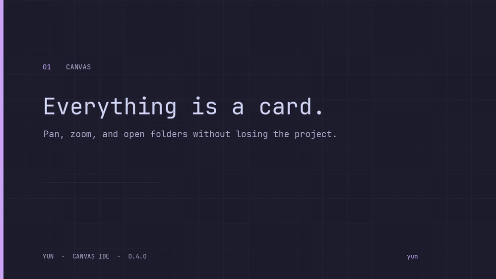

# Yun 0.5.0

Yun 0.5.0 is the canvas reliability and skinning release. It makes selection,
dragging, folders, and card stacks predictable, and adds per-surface PNG/GIF
wallpapers with an in-app Skin editor and image picker.

## Highlights

- **Stable canvas interaction** — selection no longer relayouts the canvas or
  steals focus, drag positions stay put, and draw/hit order agree. The card
  deck is diagonal and keeps stable slots (#421–#423).
- **Real folder bodies** — collapsed folders keep compact bodies with file
  counts and previews, expanded folders reserve their content bounds, and
  opening a folder closes its descendants (#421, #428, #431).
- **Per-surface skinning** — global/project skin layers, PNG/JPG/JPEG/GIF/BMP
  surfaces, rounded clipping, paper/glass cards, explorer/tray folders, and
  language accents (#426–#430).
- **Skin settings and picker** — Settings > Skin edits presets, styles,
  surfaces, image paths, fit, opacity, tint, scrim, GIF speed/FPS, and wallpaper
  scope. Paste a path, drag a file, or browse with preview and `..` navigation
  (#426, #427).
- **JPEG support** — a vendored stb decoder fills the gap left by raylib’s
  JPEG-disabled build; GIF frames now use one texture per frame and animate at
  the correct size.
- **Readable wallpapers** — wallpapers draw over an opaque surface base, so
  lowering opacity no longer exposes the canvas or other cards. Card/folder
  wallpapers default to the selected item; `skin.image_scope = all` restores
  full coverage.
- **Workspace v5** — folder bodies and layout state persist; v3/v4 workspaces
  migrate once and are re-laid out.
- **Code organization** — the project domain is split into
  `src/project/project.c3`, `paths.c3`, and `clusters.c3`, with repo skills for
  module organization, safe refactors, and the app shell.
- **Verification** — 665 tests, 23 visual-suite states, sanitizer, benchmark,
  selftest, and Linux/macOS/Windows builds.

## Canvas and folders

- Selection, focus, dragging, resizing, and grab mode are independent of layout.
- The deck/fan layouts are diagonal; selected, focused, editing, dragging, and
  grabbed cards are raised above their stack.
- Collapsed folders have a stable `240×140` body with a file count and preview
  lines; opening a folder collapses descendant folders.
- Expanded folders reserve their measured subtree bounds, and the canvas only
  reflows when the expanded content would overlap a neighbour.
- Fresh projects collapse folders before the first layout so bodies stay next
  to their files.

## Skins

- Global and project layers inherit field-by-field, with source badges and
  explicit override serialization.
- Surface images resolve relative to the config folder, support drag-and-drop,
  clipboard paste, and a file browser with image preview.
- `skin.image_scope` selects between `selected` (default) and `all`.
- Playback uses per-file `speed` and `fps`; GIF previews show the first frame.
- JPEG/JFIF decoding is built in; WebP remains unsupported.

## Downloads

| Platform | File |
| --- | --- |
| Linux x64 | `yun-0.5.0-linux-x64.tar.gz` |
| macOS arm64 | `yun-0.5.0-macos-aarch64.tar.gz` |
| Windows x64 | `yun-0.5.0-windows-x64.zip` |

Extract the archive for your platform and run `yun` (`yun.exe` on Windows).
Checksums are in `checksums.txt`.

## Known limitations

- Very large projects still spend noticeable time restoring a fresh workspace.
- LSP servers are user-supplied; none are bundled.
- No Linux arm64 or macOS x64 release artifacts.
- Windows runtime validation is still in progress (#291, #310, #260).
- #49 remains deferred until an HTTPS client exists.
